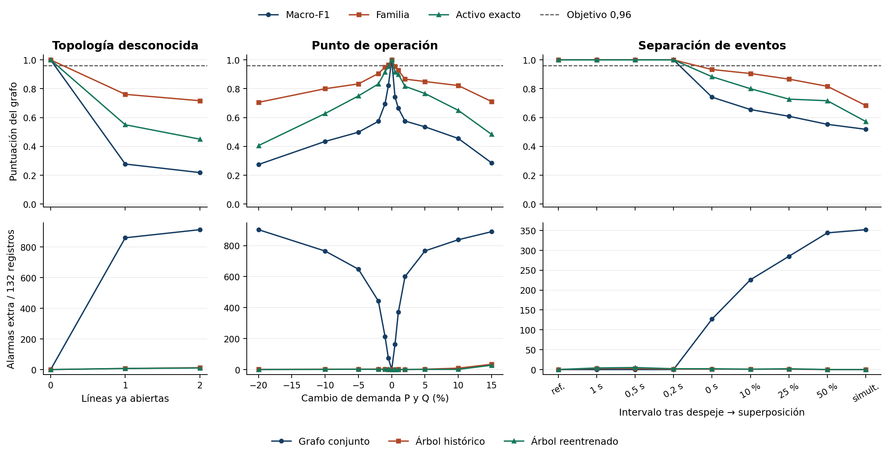

# Robustez del estimador conjunto MET_BAYES_GRAFO

En la referencia nominal el grafo clasificó y ubicó los 180 episodios con cero alarmas extra. Mantuvo ese resultado con un intervalo fijo de 0,2 s entre el despeje y la siguiente perturbación. Perdió el objetivo de 0,96 al introducir una sola apertura desconocida, al cambiar la demanda un 0,5 % en cualquiera de los dos sentidos y al iniciar el siguiente evento en el reporte de despeje del anterior. Las predicciones de todos los métodos se publicaron en `d31e419` antes de abrir las etiquetas. [Predicciones](results/predictions.json) · [Sello](results/seal.json)

| Condición | Macro-F1 del grafo | Familia / 180 | Activo exacto / 180 | Extras del grafo | Extras de los árboles históricos | Extras de la réplica |
|---|---:|---:|---:|---:|---:|---:|
| Referencia nominal | 1,0000 | 180 | 180 | 0 | 0 | 0 |
| Una línea ya abierta, desconocida | 0,2773 | 137 | 99 | 860 | 7 | 7 |
| Dos líneas ya abiertas, desconocidas | 0,2182 | 129 | 81 | 913 | 12 | 10 |
| Demanda −0,5 % | 0,8217 | 174 | 172 | 74 | 0 | 2 |
| Demanda −1 % | 0,6957 | 171 | 165 | 213 | 2 | 1 |
| Demanda +0,5 % | 0,7416 | 172 | 165 | 164 | 0 | 0 |
| Intervalo de 0,2 s tras el despeje | 1,0000 | 180 | 180 | 0 | 1 | 2 |
| Inicio en el instante de despeje | 0,7412 | 168 | 159 | 127 | 1 | 2 |
| Superposición del 25 % | 0,6088 | 156 | 131 | 285 | 1 | 2 |
| Inicios simultáneos | 0,5183 | 123 | 103 | 352 | 0 | 0 |
| Una apertura, demanda +10 % y superposición del 25 % | 0,2219 | 118 | 71 | 860 | 20 | 22 |

Los primeros cruces de macro-F1, familia y ubicación coinciden para una apertura, para demanda creciente (+0,5 %) y para separación temporal (0 s). Con demanda decreciente, macro-F1 y ubicación caen en −0,5 %, y familia cae en −1 %. El macro-F1 a −0,5 % tiene IC del 95 % de 0,7511 a 0,8992. La ubicación en ese punto fue 172/180, con intervalo del 92,22 % al 98,33 %. El umbral de 0,96 queda dentro del intervalo de ubicación. Ninguna condición examinó distancias temporales entre 0 y 0,2 s ni cambios de demanda inferiores a 0,5 % en valor absoluto. [Las 24 condiciones con ambos comparadores e intervalos](results/conditions.csv)



## Dónde aparecen los errores

Los tres modelos guardaron silencio en los controles de reposo de cada condición. Todos los extras del grafo aparecieron después del primer inicio real. Con una apertura oculta, 77 de los 84 registros perturbados tuvieron extras y 598 de los 860 avisos extra se emitieron al menos 1,5 s después del último despeje. En esta condición el grafo ubicó más episodios que el árbol histórico (99 frente a 92). Las alarmas repetidas redujeron su macro-F1 a 0,2773 frente a 0,7520 en el árbol. La exposición en reposo es corta para estimar una tasa de campo. [Matrices de confusión y diferencias pareadas](results/scores.json) · [Conteos por registro y momento](results/diagnostics.json)

Al subir la demanda un 0,5 %, el grafo todavía acertó familia y activo en los 84 primeros eventos. En los segundos acertó ambos en 63/72 y en los terceros, en 18/24. De los 164 avisos extra, 135 llevaban la etiqueta de generación y 98 llegaron al menos 1,5 s después del último despeje. Al eliminar el intervalo tras el despeje también acertó los 84 primeros, pero solo 58/72 segundos y 17/24 terceros. En ese caso, 124 de los 127 avisos extra llegaron después del último despeje. Son patrones compatibles con discrepancias en la recuperación predicha. Este ensayo no aísla la contribución causal de cada parámetro eléctrico. [Diagnóstico por posición y momento](results/diagnostics.json)

El código del observador ofrece una explicación adicional para la pérdida con superposición. Mientras sigue una perturbación activa, actualiza su duración y espera evidencia de despeje antes de volver a buscar una nueva. Su predicción física propaga un solo modo activo en cada intervalo. Para inicios simultáneos, incluso el pareo favorable al conjunto solo recuperó 135 detecciones para 180 episodios y ubicó 103. Con el pareo cronológico se ubicaron 52/180 y el macro-F1 bajó de 0,5183 a 0,3522. El orden entre dos inicios simultáneos es convencional. [Observador congelado](../joint_pmu/joint_observer.py) · [Propagación de modos](../joint_pmu/joint_physics.py) · [Sensibilidad al pareo](results/conditions.csv)

## Diseño del ensayo

Se comparó el estimador de `555057c` con dos versiones congeladas de MET_PMU_FIRMAS_ETREE. La primera es la histórica. La segunda se entrenó en el estudio anterior excluyendo las etiquetas de los activos reservados. Las tres versiones procesaron el mismo flujo de ocho PMU sin recibir el punto de operación, la topología de la planta ni el calendario de perturbaciones. El protocolo fijó las condiciones y el criterio de cruce en `d967594`, antes de generar las señales. [Protocolo](PROTOCOL.md) · [Archivos y modelos registrados](results/registration.json)

Cada condición tiene 48 controles sin eventos y 84 registros con uno, dos o tres eventos. Son 180 episodios por condición, distribuidos entre fallas de barra (51), aperturas de línea (51), pulsos de generación (39) y aumentos de carga (39). Se usaron señales y secuencias nuevas en las nueve barras y ocho ramas reservadas del examen anterior. Ruido, parámetros mecánicos e intervenciones se mantuvieron pareados al variar el factor de estrés. Las 24 condiciones comparten estos mismos 132 casos base. [Diseño y semillas](design_stress.py) · [Huellas de observaciones](results/observations.json)

Los cambios de demanda escalan P y Q juntos y emplean el despacho definido en el protocolo. Las aperturas topológicas existen desde antes del primer reporte. Se incluyeron redes conectadas, con 33 primeras aperturas distintas y 112 pares distintos (sin considerar el orden). En las pruebas con cambios de red o demanda se resolvió de nuevo el equilibrio AC de la planta antes de iniciar la dinámica. En las pruebas de superposición las perturbaciones actúan a la vez sobre el mismo estado de las máquinas. Los puntos de +17,5 % y +20 % carecieron de una solución inicial aceptable con este despacho y quedaron fuera del barrido. [Modelo del simulador](stress_plant.py) · [Equilibrios por registro](results/equilibria.json)

## Lectura de las métricas

Familia y activo exacto se calculan sobre los 180 episodios, incluidos los omitidos. Una alarma se asigna a un máximo de un episodio y debe dispararse entre el inicio y 1,5 s después. El diagnóstico debe publicarse antes de vencer el mismo plazo. Cuando varias asignaciones son posibles, el criterio registrado da prioridad al mayor número de detecciones y después a los aciertos de familia y activo. Para eventos simultáneos se evalúa el conjunto recuperado. La tabla completa incluye también el resultado al asignar alarmas en orden cronológico. El macro-F1 promedia las cuatro familias físicas. [Evaluador](score_stress.py)

Una alarma **extra** es cualquier alarma sin episodio asignado. Se cuentan por separado las de controles enteramente normales y las de registros con eventos. Cada condición aporta 18,4 minutos evaluables de controles tras el arranque. Los mismos controles de reposo se repiten al variar la separación temporal. Los intervalos del 95 % usan 4.000 remuestreos de registros completos estratificados por número de eventos. El primer cruce identifica el primer nivel medido con una puntuación inferior a 0,96. Los puntos intermedios quedan sin medir. [Resultados por condición e intervalos](results/conditions.csv)

## Reproducción

Desde la raíz del repositorio:

```powershell
python experiments/frozen_stress/report/audit.py
python experiments/frozen_stress/report/publish.py
python experiments/frozen_stress/report/diagnostics.py
```

La auditoría comprueba los sellos y vuelve a contar las métricas enumerando todas las asignaciones admisibles entre alarmas y episodios. Para repetir la simulación completa, establezca `P07_SCIENCE_ARCHIVE` en la raíz del archivo científico SGSMA y limite BLAS a un hilo. El siguiente comando reconstruye las 24 matrices de PMU en una carpeta temporal, comprueba las huellas registradas y repite el diagnóstico de los tres modelos en seis condiciones:

```powershell
$env:OPENBLAS_NUM_THREADS = '1'
$env:OMP_NUM_THREADS = '1'
$env:MKL_NUM_THREADS = '1'
python experiments/frozen_stress/report/audit.py --regenerate
```

La repetición reprodujo las 24 matrices de PMU y los equilibrios registrados. Los tres monitores reprodujeron sus avisos sellados en los seis casos de control. El recuento independiente verificó las 72 combinaciones de condición y monitor. En cuatro evaluaciones de registro, empates en el pareo admitían matrices de confusión distintas con el mismo valor del criterio registrado. Se comprobó que la asignación publicada pertenecía al conjunto óptimo en cada una. [Auditoría ejecutable](report/audit.py)
