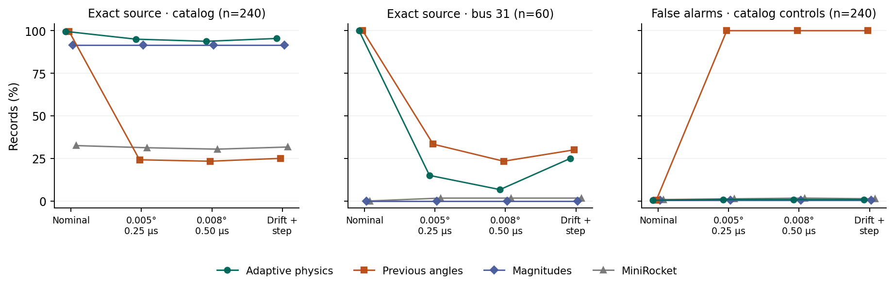

# Successive-event performance of the quality-adaptive physical estimator

MET_BAYES_GRAFO_ADAPTATIVO estimates whether a second load or line intervention occurred after the first switch cleared. It reports the family and exact bus or branch from eight PMUs. The frozen decision rule uses phase differences across the network when the initial PMU history supports the nominal noise law. Under angular perturbations it uses same-instrument voltage/current phase and magnitudes, with a separately trained likelihood correction for BUS31. The correction learned from previously simulated BUS31 examples. Its transfer to other weak or unseen assets remains untested.

On the nominal nine-second catalog the estimator localized 239/240 events with one alarm on controls. Moderate angular and timing errors reduced exact location to 228/240, with two control alarms. All twelve misses were at BUS31. Extending the nominal decision window to 30 seconds increased alarms to 44/48 controls. The archived recovery dictionary ends 271 reports after clearance and the implementation holds its last value thereafter. This limits the early estimator’s supported monitoring horizon.

The successor extends these curves to 30 s and was tested on new early and late switches. [Successor and independent results](long_horizon/RESULTS.md)

## Fresh paired P2 test

The catalog includes 240 second events and 240 matched recoveries without a second event. Each efficacy denominator includes all 240 events. The known first clearance initializes the recovery model. The alarm must fall inside the second event, and its family and source decision must arrive before the event clears. Both members of each pair share the first event and the noise history. Four conditions repeat the same records.

| Condition | Independent detector | Macro-F1 | Detected /240 | Family /240 | Exact /240 | Alarmed controls /240 | Early alarms /240 |
|---|---|---:|---:|---:|---:|---:|---:|
| Nominal | MET_BAYES_GRAFO_ADAPTATIVO | 0.9958 | 239 | 239 | 239 | 1 | 1 |
| Nominal | Previous relative angles | 0.9958 | 239 | 239 | 239 | 1 | 1 |
| Nominal | Previous magnitudes | 0.9589 | 222 | 222 | 220 | 1 | 0 |
| Nominal | MiniRocket | 0.5606 | 86 | 81 | 78 | 2 | 1 |
| 0.005° + 0.25 µs | MET_BAYES_GRAFO_ADAPTATIVO | 0.9702 | 228 | 228 | 228 | 2 | 0 |
| 0.005° + 0.25 µs | Previous relative angles | 0.1834 | 58 | 58 | 58 | 240 | 182 |
| 0.005° + 0.25 µs | Previous magnitudes | 0.9589 | 222 | 222 | 220 | 1 | 0 |
| 0.005° + 0.25 µs | MiniRocket | 0.5473 | 83 | 78 | 75 | 3 | 1 |
| 0.008° + 0.50 µs | MET_BAYES_GRAFO_ADAPTATIVO | 0.9635 | 225 | 225 | 225 | 2 | 0 |
| 0.008° + 0.50 µs | Previous relative angles | 0.1818 | 57 | 57 | 56 | 240 | 183 |
| 0.008° + 0.50 µs | Previous magnitudes | 0.9589 | 222 | 222 | 220 | 1 | 0 |
| 0.008° + 0.50 µs | MiniRocket | 0.5344 | 81 | 76 | 73 | 4 | 2 |
| Drift and step | MET_BAYES_GRAFO_ADAPTATIVO | 0.9724 | 229 | 229 | 229 | 2 | 0 |
| Drift and step | Previous relative angles | 0.1903 | 60 | 60 | 60 | 240 | 180 |
| Drift and step | Previous magnitudes | 0.9589 | 222 | 222 | 220 | 1 | 0 |
| Drift and step | MiniRocket | 0.5527 | 82 | 80 | 76 | 3 | 1 |

### Additional BUS31 panel

Each condition includes the same 60 independently generated BUS31 events and their 60 matched controls. Correct family and location remain subject to the publication deadline.

| Condition | Detected /60 | Family /60 | Exact /60 | Alarmed controls /60 | BUS31 misses in the general catalog |
|---|---:|---:|---:|---:|---:|
| Nominal | 60 | 60 | 60 | 0 | 0 |
| 0.005° + 0.25 µs | 11 | 9 | 9 | 0 | 12 |
| 0.008° + 0.50 µs | 4 | 4 | 4 | 0 | 15 |
| Drift and step | 16 | 15 | 15 | 0 | 11 |

### Published classification methods on the same graph triggers

The denominator here contains only positive catalog records with a graph trigger early enough to publish. HYDRA predicts one of 18 sources. CNN-F predicts the family. They inherit the graph detector's alarms. MiniRocket in the first table uses its own detector and source head.

| Condition | Eligible | Physical family | CNN-F family | HYDRA family | Physical exact | HYDRA exact |
|---|---:|---:|---:|---:|---:|---:|
| Nominal | 239 | 239 | 198 | 230 | 239 | 157 |
| 0.005° + 0.25 µs | 228 | 228 | 189 | 215 | 228 | 154 |
| 0.008° + 0.50 µs | 225 | 225 | 185 | 213 | 225 | 155 |
| Drift and step | 229 | 229 | 190 | 216 | 229 | 155 |

The CNN-F reference is the repository's frozen two-family adaptation with DMD recovery subtraction. MiniRocket and HYDRA use the authors' multivariate convolution transforms, locally fitted heads and reduced feature budgets. Angular errors were added to the reported phasors, while simulated frequency and ROCOF were retained. [Li and Wang](https://sites.ecse.rpi.edu/~wang/pub/TPWRS19_2.pdf) · [MiniRocket reference code](https://github.com/angus924/minirocket) · [HYDRA reference code](https://github.com/angus924/hydra)

PI-MSA also combines grid physics, topology and event attribution at buses and branches. Its published evaluation spans multiple power systems. We did not find a verified executable for this comparison. The claims above concern the methods actually run on these measurements. [Sima et al., IEEE Transactions on Industrial Informatics](https://doi.org/10.1109/TII.2026.3682628)

## Submitted June model on its native decision window

The 48 prespecified catalog pairs each contribute a 900-report post-clearance window. The timing requirement is relaxed to one decision at window close. The June ZIP sees the same post-clearance reports converted to the prescribed balanced three-phase schema. The graph and MiniRocket also use their separate startup history. Each eligible positive contributes to the exact family-and-site denominator. The submitted model was trained on competition windows. This evaluation measures transfer to recovery with a possible second event.

| Condition | Method | Macro-F1 E0/E2/E4 | Detected /48 | Family /48 | Exact /48 | Alarmed controls /48 |
|---|---|---:|---:|---:|---:|---:|
| Nominal | MET_BAYES_GRAFO_ADAPTATIVO | 0.5585 | 48 | 48 | 48 | 44 |
| Nominal | MiniRocket | 0.5632 | 19 | 16 | 16 | 1 |
| Nominal | MET_HACKATON_ETREE | 0.3718 | 9 | 6 | 0 | 1 |
| 0.005° + 0.25 µs | MET_BAYES_GRAFO_ADAPTATIVO | 0.6459 | 48 | 48 | 48 | 37 |
| 0.005° + 0.25 µs | MiniRocket | 0.5834 | 19 | 17 | 16 | 1 |
| 0.005° + 0.25 µs | MET_HACKATON_ETREE | 0.3718 | 9 | 6 | 0 | 1 |

The June ZIP SHA-256 is e0bfc17e4c5ee9b595fa51fd94d736145c2f48755696c8d2eadcff00cb23a243. The full-window comparison uses scikit-learn 1.7.2, as in its serialized weights. The wrapper takes the original feature-builder and predictor outputs before they are broadcast over all PMUs and report times.

## Evidence and reproduction

Freeze commit `c14f2fe` fixes the development decision, all comparator weights and the fresh design. Commit `8c1f952` contains the opaque measurements and target hash. Commit `9b372e9` sealed all experimental predictions before label release. Point estimates, marginal one-sided 95% bounds, full confusion matrices and paired discordances are available in [summary.json](results/summary.json). Per-site misses are in [source_errors.json](results/source_errors.json).

Use [graph_estimator.py](graph_estimator.py) to load the frozen estimator and call `predict(measurements, clearance)` with a growing prefix. The four phasor fields are arrays of shape (reports, 8). The docstring specifies units and bus order. The first second must be quiet. An empty label means the method has yet to publish a diagnosis.

From this directory, run `python replay.py --all` to restore the 600 archived records and reproduce the physical and literature predictions. Run `python adjudicate.py` and `python audit_counts.py` to recompute the reported scores. For the original submission, place the verified June ZIP at `tmp/competition_original.zip` in the repository root and provide scikit-learn 1.7.2. The two earlier physical-model manifests and the trained comparator dependencies are pinned in [freeze.json](results/freeze.json). The training and rerun protocol is in [PROTOCOL.md](PROTOCOL.md).
The independent quiet-stream audit contained 36 disclosed event-free traces and 5.861 eligible hours per noise condition. The adaptive gate gave zero threshold-crossing episodes in nominal, joint and drift/step conditions and two under severe angular noise. The earlier magnitude detector gave zero in each. These hours characterize stable operation. The paired 30-second recovery controls above measure a different source of false alarms.
