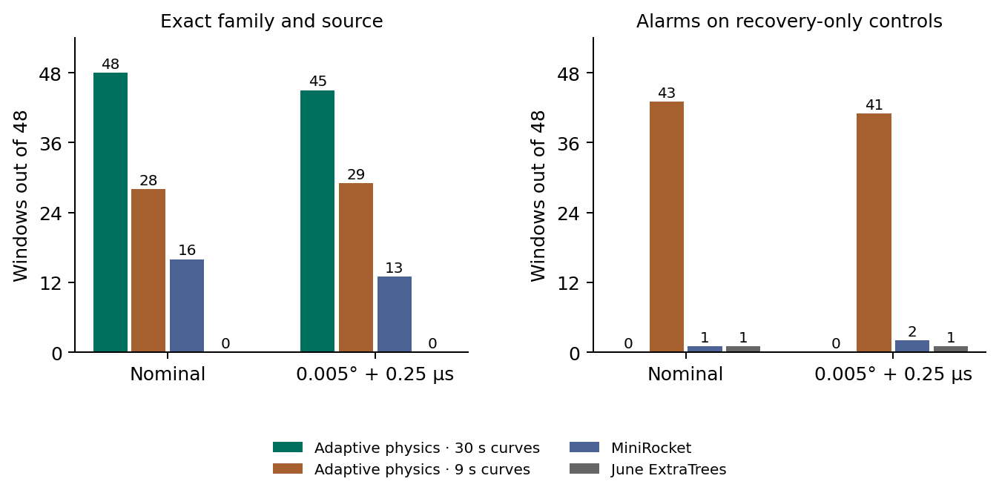

# MET_BAYES_GRAFO_30S

MET_BAYES_GRAFO_30S is the recommended P2 estimator for detecting and locating a second load or line switch with eight PMUs. The preceding estimator reused the last point of its recovery trajectory after nine seconds. Reintegrating 738 first-event trajectories through 30 seconds gives the null hypothesis the continuing swing response against which a second intervention must compete. The correction adds 630 reports to each physical trajectory. The original first 271 reports are copied verbatim. The thresholds, class models and decision delay are identical. Gaussian likelihoods rank candidate physical responses under their assumed noise model. The quality selector, empirically calibrated thresholds and BUS31-specific learned decision rule make the deployed architecture a hybrid estimator. Its experiments establish neither global Bayes optimality nor priority over other physics-informed graph methods.

**Independent result.** The extended model detected, classified and located all 96 nominal events in time. Under joint phasor noise it achieved 86/96 on each endpoint with zero alarms in 96 controls. It located all 84 events outside BUS31 and two of the twelve BUS31 loads. On that mix, reaching 95% would require six additional BUS31 hits while preserving all 84 other sites. Reaching 96% would require seven.

## New blind test

There are 96 true second events and 96 matched controls with no second event. Forty-eight second events occur 1.25–4 s after the first clearance and 48 occur 14–24 s afterward. Each group contains all four ordered load/line combinations equally. The control monitor runs for the full 30 s. For timely efficacy, the alarm must occur within the event, and the family/site must be published before the second clearance.

| Timing | Instrument error | Curve | Detection | Family | Exact | Alarmed controls | Macro-F1 E0/E2/E4 |
|---|---|---|---:|---:|---:|---:|---:|
| all | Nominal | 30 s | 96/96 | 96/96 | 96/96 | 0/96 | 1.0000 |
| all | Nominal | 9 s | 54/96 | 54/96 | 54/96 | 86/96 | 0.3990 |
| all | 0.005° + 0.25 µs | 30 s | 86/96 | 86/96 | 86/96 | 0/96 | 0.9447 |
| all | 0.005° + 0.25 µs | 9 s | 52/96 | 52/96 | 52/96 | 82/96 | 0.4149 |
| early | Nominal | 30 s | 48/48 | 48/48 | 48/48 | 0/48 | 1.0000 |
| early | Nominal | 9 s | 48/48 | 48/48 | 48/48 | 44/48 | 0.5585 |
| early | 0.005° + 0.25 µs | 30 s | 43/48 | 43/48 | 43/48 | 0/48 | 0.9447 |
| early | 0.005° + 0.25 µs | 9 s | 43/48 | 43/48 | 43/48 | 44/48 | 0.5257 |
| late | Nominal | 30 s | 48/48 | 48/48 | 48/48 | 0/48 | 1.0000 |
| late | Nominal | 9 s | 6/48 | 6/48 | 6/48 | 42/48 | 0.1565 |
| late | 0.005° + 0.25 µs | 30 s | 43/48 | 43/48 | 43/48 | 0/48 | 0.9447 |
| late | 0.005° + 0.25 µs | 9 s | 9/48 | 9/48 | 9/48 | 38/48 | 0.2401 |

## Original June ZIP and MiniRocket at window close

A prespecified balanced subset contains 48 positive and 48 control windows. Both event schedules are equally represented. The original ZIP classifies the 900 post-clearance reports as one window. The proposed streaming estimator and MiniRocket additionally use their startup history. An out-of-scope code counts as a false alarm on a control and a wrong family on a positive. Exact requires correct family and correct site.

| Error | Model | Detected /48 | Family /48 | Exact /48 | Alarmed controls /48 | Macro-F1 |
|---|---|---:|---:|---:|---:|---:|
| Nominal | MET_BAYES_GRAFO_30S | 48 | 48 | 48 | 0 | 1.0000 |
| Nominal | 9 s recovery | 48 | 38 | 28 | 43 | 0.4669 |
| Nominal | MET_HACKATON_ETREE | 14 | 8 | 0 | 1 | 0.4166 |
| Nominal | MiniRocket | 19 | 17 | 16 | 1 | 0.5791 |
| 0.005° + 0.25 µs | MET_BAYES_GRAFO_30S | 45 | 45 | 45 | 0 | 0.9677 |
| 0.005° + 0.25 µs | 9 s recovery | 47 | 38 | 29 | 41 | 0.4978 |
| 0.005° + 0.25 µs | MET_HACKATON_ETREE | 14 | 8 | 0 | 1 | 0.4166 |
| 0.005° + 0.25 µs | MiniRocket | 17 | 15 | 13 | 2 | 0.5424 |

## Attribution on the same timely triggers

HYDRA and the sparse-PMU adaptation of Li–Wang CNN-F share the physical trigger and the 29-report publication delay. The original CNN-F task predicts an event family. HYDRA was fitted to the 18 candidate sources. The comparison isolates attribution from detector sensitivity. [Li and Wang](https://sites.ecse.rpi.edu/~wang/pub/TPWRS19_2.pdf) · [HYDRA](https://github.com/angus924/hydra) · [MiniRocket](https://github.com/angus924/minirocket)

| Error | Eligible | Physics family | CNN-F family | HYDRA family | Physics exact | HYDRA exact |
|---|---:|---:|---:|---:|---:|---:|
| Nominal | 96 | 96 | 87 | 96 | 96 | 73 |
| 0.005° + 0.25 µs | 86 | 86 | 77 | 86 | 86 | 69 |

## Limits of the claim

- Nominal: 96/96 timely exact (one-sided 95% lower bound 96.9%); 0/96 control alarms (upper bound 3.1%). BUS31 contributed 12/12 exact calls to this general catalog.
- 0.005° + 0.25 µs: 86/96 timely exact (one-sided 95% lower bound 83.0%); 0/96 control alarms (upper bound 3.1%). BUS31 contributed 2/12 exact calls to this general catalog.

In the independent BUS31-focused early-event panel the released estimator reproduced 60/60 nominal exact calls, 9/60 under 0.005° plus 0.25 µs, and 4/60 under 0.008° plus 0.50 µs. Those 60 positives exhaust the denominator at each level. The exact effect of severe noise on late events has yet to be measured. The simulator, network parameters, PMUs, known first-clearance convention and catalog are shared with fitting. Recovery was extended to 30 seconds. Continued monitoring beyond that horizon has not been established.

## Evidence

The physical extension was frozen in `7e0acab`. Inputs and the label commitment were archived separately in `c14d305`. The calls were sealed in `797c295` before scoring. The release replay checked every one of the 792 archived records in the two prospective experiments and reproduced all 2,784 predicted physical decisions across their noise conditions.

Load the released estimator from [recommended.py](../recommended.py). Supply voltage and current magnitude and angle arrays for PMUs 2, 5, 6, 10, 19, 22, 29 and 39, at 30 Hz. Voltage magnitude is phase-neutral volts, current magnitude amperes and both angles degrees. The first second is quiet. The input clearance is the absolute report index of the first restoration.

    from recommended import load_estimator
    model = load_estimator()
    decision = model.predict(measurements, clearance)

Run `python ../verify_release.py` in this directory to restore all measurement archives and replay the released model. Run `python benchmark_long.py score`, `python literature_long.py score` and `python verify_results.py` to reproduce the tables and figure. The [paired nine-class M9 comparison](../m9/README.md) uses a different generator and method. The [first blind experiment](../RESULTS.md) documents four instrument conditions and the initial 30-second failure.
